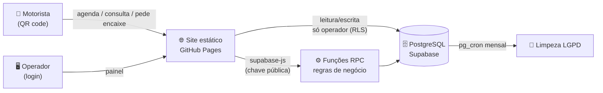

# 🚛 Agenda Operacional: agendamento de inspeção veicular e treinamento de segurança

> Sistema web que **substituiu o agendamento por telefone** em um terminal de distribuição de combustíveis. O motorista agenda pelo celular lendo um QR code, e a equipe acompanha tudo em um painel único.


💰 **Custo de infraestrutura: R$ 0** · ⚙️ **Sem servidor próprio** · 📱 **Pensado para o celular**

---

## 🎯 O problema

Para carregar em um terminal de combustíveis, todo caminhão passa por uma **inspeção de segurança (checklist)**, e os motoristas novos precisam fazer um **curso de prevenção de derramamento**. Antes do sistema:

- 📞 o agendamento era feito **por telefone ou WhatsApp**, um motorista por vez, ocupando a equipe da portaria;
- ❓ o motorista não sabia se havia vaga antes de sair;
- 🦺 muitos chegavam **sem o EPI ou o documento exigido** e perdiam a viagem;
- 📝 a lista de inscritos do curso, a presença e os relatórios eram montados **à mão**.

## 💡 A solução

Um sistema web com duas pontas:

| 📱 Motorista (sem login) | 🖥️ Operador (com login) |
|---|---|
| Lê o QR code da portaria e agenda em 4 etapas | Vê a fila do dia com contadores em tempo real |
| Vê na hora os horários livres (verde) e lotados (vermelho) | Faz check-in lendo o QR do motorista pela câmera |
| Sem vaga? **Pede um encaixe** e acompanha a resposta | Aprova encaixes e avisa o motorista pelo WhatsApp em 1 clique |
| Recebe código, QR e **instruções do dia** (EPI, documentos) | Gera horários em lote para o ano inteiro |
| Consulta e cancela sozinho, e a vaga volta na hora | Exporta relatórios em Excel e gera certificados em PDF |

---

## 📈 Ganho operacional

| Processo | ❌ Antes | ✅ Depois |
|---|---|---|
| Marcar horário | Ligação ou mensagem para a portaria | Autoatendimento 24h pelo celular |
| Ver disponibilidade | Perguntar para alguém | Vagas em tempo real |
| Sem vaga | Pedido informal, sem registro | Fila de encaixe com aprovação e histórico |
| Orientações de segurança | Explicadas uma a uma | Entregues a todos, de forma padronizada, antes da chegada |
| Chegada | Busca manual em lista | Check-in por QR code em segundos |
| Desistência | Horário ficava preso | Cancelamento online libera a vaga |
| Curso de segurança | Lista feita à mão | Inscrição online, lista de presença e certificado em PDF |
| Relatórios | Planilha manual | Excel por período em 1 clique |

**Na prática:**
- ⏱️ **Menos tempo da equipe ao telefone.** O agendamento deixou de depender de um atendente.
- 🚦 **Chegadas distribuídas.** Horários com limite de vagas evitam fila de caminhões no gate.
- 🦺 **Mais conformidade.** Todo motorista recebe as mesmas regras de EPI e documentação antes de vir.
- 📊 **Decisão com dados.** No-show, pendências e demanda por horário passam a ser medidos.

### 📏 Como o impacto é medido

O próprio sistema registra cada agendamento, chegada e status, e os indicadores saem direto do Excel exportado:

| Indicador | Fórmula |
|---|---|
| Atendimentos evitados | agendamentos pelo site + cancelamentos pelo site |
| Horas da equipe economizadas | atendimentos evitados × minutos por ligação ÷ 60 |
| Taxa de no-show | agendados sem check-in ÷ total agendado |
| Ocupação da agenda | agendados ÷ vagas oferecidas |
| Encaixes atendidos | encaixes aprovados ÷ encaixes pedidos |

---

## 👨‍💻 Meu papel

Projeto feito **de ponta a ponta por mim**, como iniciativa própria, a partir de um problema que eu vivia na operação:

- 🔍 levantamento do processo com a equipe e definição das regras de negócio;
- 🎨 interface mobile-first, com tema claro e escuro e foco em quem usa no pátio;
- 🗄️ modelagem do banco, regras de segurança e funções em PostgreSQL;
- 🧪 testes das regras de negócio direto no banco (concorrência, duplicidade, permissões);
- 🚀 implantação, treinamento dos operadores e evolução a partir do feedback de uso.

---

## 🛠️ Destaques técnicos

- 🔐 **Segurança no banco, não no front.** Row Level Security no PostgreSQL: o motorista não lê nenhuma tabela, só chama funções (`SECURITY DEFINER`) que devolvem os próprios dados dele.
- ⚡ **Sem corrida pela última vaga.** O agendamento usa `SELECT ... FOR UPDATE`, então dois motoristas não conseguem pegar a mesma vaga ao mesmo tempo.
- 🧩 **Regras de negócio no SQL:** uma placa por dia no checklist, uma turma futura por CPF no curso, um pedido de encaixe pendente por placa e por dia, bloqueio de horários passados.
- 🔁 **Fluxo de aprovação:** aprovar um encaixe cria o horário (ou amplia as vagas) e o agendamento em uma única transação.
- 🛡️ **LGPD:** consentimento obrigatório, política de privacidade, acesso restrito e exclusão automática dos dados após 12 meses (`pg_cron`).
- 📱 **PWA:** instalável na tela inicial do celular, com service worker.
- 📷 **Leitura de QR pela câmera** no navegador para o check-in.
- 📄 **Geração no navegador:** Excel (SheetJS), certificados em PDF (jsPDF) e evento de calendário (.ics) com as instruções do dia.
- 🪶 **Zero build.** HTML, CSS e JavaScript puro, fácil de manter por quem não é desenvolvedor.
- ⚙️ **Configurável sem código:** textos, contatos, orientações e regras ficam em um único `config.js`.

---

## 🏗️ Arquitetura



**Tabelas:** `horarios` · `agendamentos` · `encaixes` · `operadores`
**Funções públicas:** `horarios_disponiveis`, `datas_disponiveis`, `agendar`, `consultar_agendamento`, `cancelar_agendamento`, `solicitar_encaixe`, `consultar_encaixe`
**Funções do operador:** `gerar_horarios`, `aprovar_encaixe`, `limpar_dados_antigos`

---

## 🖼️ Telas

> Adicione aqui os prints: agendamento no celular, confirmação, painel do dia, encaixes e check-in.

| Agendamento | Confirmação | Painel |
|---|---|---|
| `docs/agendar.png` | `docs/confirmacao.png` | `docs/painel.png` |

---

## 🚀 Como rodar

1. Crie um projeto no [Supabase](https://supabase.com) e rode o `schema.sql` no **SQL Editor**.
2. Em **Authentication**, desative o cadastro aberto, crie o usuário operador e rode o `2_operador.sql`.
3. Preencha a URL e a chave **publishable** no `config.js`.
4. Publique os arquivos no **GitHub Pages** (branch `main`, pasta raiz).
5. No painel, gere os horários e imprima o cartaz com o QR code.

Para testar localmente: `python -m http.server 8000` e abra `http://localhost:8000`.

---

## 📁 Estrutura

```
index.html                # 📱 site do motorista
admin.html                # 🖥️ painel do operador
privacidade.html          # 🛡️ política de privacidade
config.js                 # ⚙️ textos, contatos e regras
styles.css                # 🎨 visual (tema claro e escuro)
common.js                 # 🔧 funções compartilhadas
agendar.js                # 📅 fluxo do motorista
admin.js                  # 📊 fluxo do operador
manifest.webmanifest, sw.js, icon*   # 📲 PWA
schema.sql                # 🗄️ banco, regras e funções
2_operador.sql            # 👤 primeiro operador
3_limpeza_automatica.sql  # 🧹 limpeza LGPD agendada
```

---

## 🔮 Próximos passos

- [ ] Aviso automático ao motorista na véspera do horário
- [ ] Envio do certificado do curso por e-mail
- [ ] Troca de senha pelo próprio operador
- [ ] Dashboard com os indicadores de impacto

---

## 👋 Autor

**Caique Andrade**: profissional de operações logísticas que desenvolve automações e sistemas para resolver problemas reais do dia a dia operacional.

🔗 [GitHub](https://github.com/CAIQUE4NDRADE)
